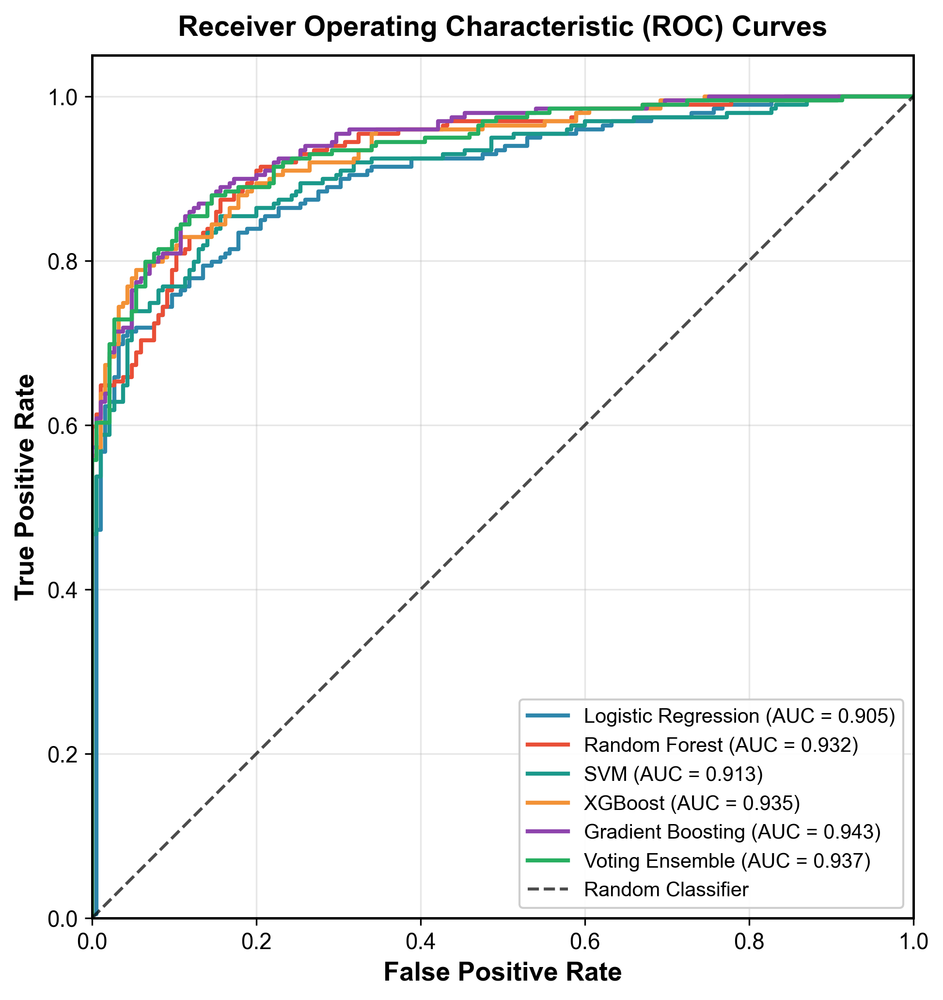
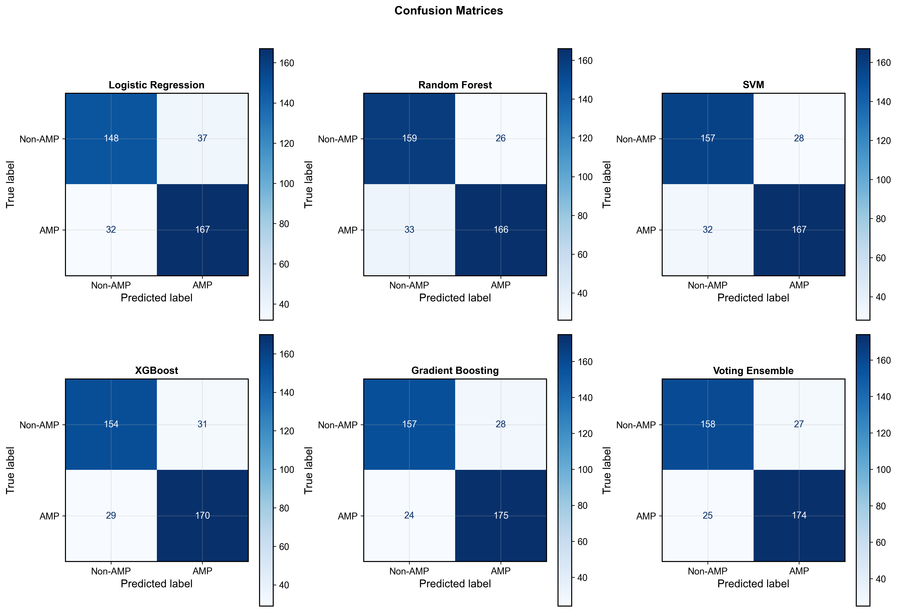
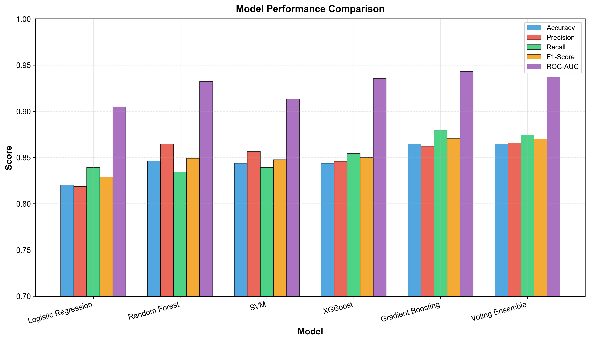
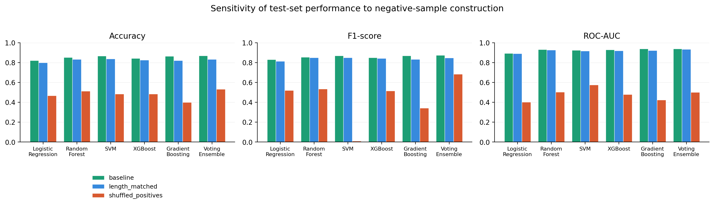

<div align="center">

# AMP-ML

**A reproducible, independently audited machine learning benchmark for antimicrobial peptide classification**

[](https://github.com/ssinder/ampml/actions/workflows/ci.yml)
[](https://github.com/ssinder/ampml/actions/workflows/cff-validator.yml)
[](LICENSE)
[](https://www.python.org/)
[](https://github.com/ssinder/ampml)
[](https://colab.research.google.com/github/ssinder/ampml/blob/main/notebooks/quickstart.ipynb)

</div>

---

Antimicrobial peptide (AMP) activity prediction is a small-n, high-dimensional
problem where **the reported number is usually less trustworthy than the
pipeline that produced it**. Most AMP classifiers report a single accuracy
number with no held-out protocol, no audit trail, and no way to tell whether the
model learned antimicrobial activity or learned the difference between how
positive and negative peptides were collected.

AMP-ML is built around the opposite premise: **the evaluation protocol is the
contribution**. It ships a complete, one-command reproduction pipeline, a
five-layer independent verification audit over 30 numerical checks, a held-out
test set that is never touched during model selection, SHAP-based attribution,
and — importantly — an explicit, quantified audit of the negative-sample
distribution bias that dominates this field.

<div align="center">

</div>

---

## Table of contents

- [What makes this different](#what-makes-this-different)
- [Results](#results)
- [Quick start](#quick-start)
- [Command line interface](#command-line-interface)
- [Dataset](#dataset)
- [Pipeline](#pipeline)
- [Verification audit](#verification-audit)
- [Limitations](#limitations)
- [Repository layout](#repository-layout)
- [Citation](#citation)
- [Contributing](#contributing)
- [License](#license)

---

## What makes this different

| | Typical AMP classifier | AMP-ML |
|---|---|---|
| Evaluation | accuracy on a random split | held-out test set (n=384), never used for selection |
| Reproducibility | "code available" | one command, 30 automated numerical checks |
| Audit trail | none | machine-readable audit report + human summary |
| Interpretability | feature importance plot | SHAP attribution with per-model values |
| Negative-sample bias | not mentioned | **quantified: ~2.8 accuracy points come from the negative set being easier** |
| Feature claim | often overstated | dimension accounting with zero discrepancy |

Two claims we make deliberately, and only these two:

1. **This pipeline is reproducible and independently auditable.** Not "the code
   runs" — a five-layer audit recomputes 30 numbers and checks them against the
   shipped artifacts.
2. **Negative-sample bias is a first-class result, not a footnote.** See
   [How much of the accuracy is real?](#how-much-of-the-accuracy-is-real).

We do **not** claim state-of-the-art accuracy, and we do not claim this is the
first AMP classifier. Our benchmark accuracy is **0.8646**; several published
methods report higher numbers under protocols we cannot verify.

---

## Results

Independent test set (n=384), which was never used for feature selection or
model selection. Source: `results/model_comparison_data.csv`.

| Model | Accuracy | F1 | ROC-AUC | Miss rate |
|---|---|---|---|---|
| **Gradient Boosting** (recommended) | **0.8646** | 0.8706 | **0.9432** | 12.06% |
| Voting Ensemble | 0.8646 | 0.8700 | 0.9369 | 12.56% |
| Random Forest | 0.8464 | 0.8491 | 0.9322 | 16.58% |
| XGBoost | 0.8438 | 0.8500 | 0.9354 | 14.57% |
| SVM | 0.8438 | 0.8477 | 0.9132 | 16.08% |
| Logistic Regression | 0.8203 | 0.8288 | 0.9049 | 16.08% |

> **Miss rate** = FN / (FN + TP), the share of true antimicrobial peptides that
> the model fails to flag. This is the metric that matters for screening, and it
> is the one most often omitted. For a screening tool, a 12% miss rate means
> roughly 1 in 8 actives would be discarded without review.

<div align="center">

</div>

<div align="center">

</div>

> Cross-validation scores on the training set are **not** acceptance numbers and
> are not comparable to the table above. They are systematically inflated
> (e.g. Logistic Regression reaches 0.9385 under 5-fold CV but 0.8203 on the
> held-out test set). Both are reported in `results/` for completeness; only the
> test set is used for acceptance.

---

## Quick start

### Option 1 — Colab (zero setup, ~30 seconds)

Open [`notebooks/quickstart.ipynb`](notebooks/quickstart.ipynb) in Colab. It
loads the shipped models and the test set, prints the metrics table above, and
draws the ROC curves. No training, no data download.

### Option 2 — Local reproduction (full pipeline, ~15 minutes)

```bash
git clone https://github.com/ssinder/ampml.git
cd ampml

python3.13 -m venv venv
./venv/bin/pip install -r requirements.txt

# Fetch the 78 MB upstream feature table (distributed as a release asset,
# verified against its MD5 so you know you got the right file)
./venv/bin/python scripts/download_data.py

# Gate 1: the environment must pass before anything else runs
./venv/bin/python src/00_check_environment.py

# Gate 2: reproduce everything, then audit the result
bash run_all.sh
```

`run_all.sh` supports `--list` (show stages), `--from NN` (resume), `--only`
(select stages) and `--clean` (wipe artifacts and start from zero).

### Option 3 — Just the numbers

```bash
pip install -e .
ampml benchmark
```

```
             Model  Accuracy  F1-Score  ROC-AUC
Logistic Regression   0.8203    0.8288    0.9049
       Random Forest   0.8464    0.8491    0.9322
                SVM   0.8438    0.8477    0.9132
            XGBoost   0.8438    0.8500    0.9354
  Gradient Boosting   0.8646    0.8706    0.9432
   Voting Ensemble   0.8646    0.8700    0.9369
```

---

## Command line interface

```bash
ampml predict --input examples/example_features.csv --output preds.csv
ampml benchmark --format json
ampml verify          # runs the five-layer audit
```

`predict` scores a feature table with the Gradient Boosting model and writes
predicted labels plus both class probabilities. The last column of the input is
treated as the ground-truth label unless `--no-label` is passed.

---

## Dataset

| Property | Value |
|---|---|
| Total samples | 2557 |
| Class balance | L0 = 1231 (non-antimicrobial) / L1 = 1326 (antimicrobial) |
| Raw features | 4921 dimensions |
| Selected features | 300 (93.9% compression) |
| Split | train 1789 / val 384 / test 384 (stratified, seed = 42) |

### Feature composition (dimension accounting reconciles exactly)

| Source | Dimensions | Contents |
|---|---|---|
| iFeature | 4484 | CKSAAP 2400 / DPC 400 / DDE 400 / KSCTriad 343 / CTriad 343 / CTDD 195 / CKSAAGP 150 / GTPC 125 / CTDT 39 / CTDC 39 / GDPC 25 / AAC 20 / GAAC 5 |
| PseKRAAC | 425 | 17 types × 25 |
| modlamp | 12 | Length / Isoelectric_Point / Hydrophobic_Ratio / Eisenberg_Moment / KyteDoolittle_Moment / AutoCorr 0–6 |

**4484 + 425 + 12 = 4921**, with zero discrepancy.

> **Note on descriptor availability.** Five descriptors — PAAC, APAAC, Moran,
> Geary and NMBroto — **failed during upstream computation** and are therefore
> **not** part of the 4921 dimensions used here. We state this explicitly
> because we would rather under-promise than have a reproducer discover the gap.
> The 4921-dimensional table is the actual, verified dimension count.

> The `_standard` suffix in `all_features_combined_standard.csv` refers to
> **standardized naming** (unified column headers), not numerical
> standardization.

### Data provenance

| Class | Source | Count | Construction |
|---|---|---|---|
| L0 (non-antimicrobial) | UniProt | 1231 | `reviewed:true AND length:[1 TO 60]` query → heuristic negative filtering → MMseqs2 de-duplication |
| L1 (antimicrobial) | DRAMP / dbAMP / APD / CampDB | 1326 | multi-database merge → de-duplication + length ≤ 60 → MMseqs2 de-duplication |

---

## Pipeline

```
rawdata/all_features_combined_standard.csv   (2557 × 4921, upstream output)
        │
        ├─ 01_data_preparation.py     preprocessing, imputation, scaling, stratified split
        ├─ 02_feature_selection.py    5-method competition → 300 features
        ├─ 03_model_training_cv.py    6 models, nested 5-fold CV + test-set evaluation
        ├─ 03b_generate_cv_curves.py  CV curve data
        ├─ 04b_generate_figures.py    publication figures
        ├─ 05_shap_analysis.py        SHAP attribution
        ├─ 06_voting_ensemble.py      inference with the ensemble model
        └─ 99_verify_test_metrics.py  ★ five-layer verification audit
```

The upstream sequence construction and feature extraction live in
[`ampmodel/`](ampmodel/) and are archived as an unmodified snapshot.

### The five engineering contracts

These are not style preferences — breaking any of them silently invalidates
published numbers.

1. **Single seed source.** `RANDOM_STATE = 42` lives only in `src/config.py`.
   Business scripts import it; they never define it.
2. **Column-order contract.** The label column is always the **last** column.
   Downstream code uses `iloc[:, :-1]` for features and `iloc[:, -1]` for labels.
3. **Path contract.** All paths derive from `config.py`'s `ROOT`. No hardcoded
   absolute paths. Scripts run correctly from any working directory.
4. **Sample IDs stay out of the main CSV.** They live in
   `data/sample_id_mapping.csv`.
5. **`results/` and `data/` are the numerical single source of truth.** Every
   number in this README and in `docs/` is generated from those files.

---

## Verification audit

`src/99_verify_test_metrics.py` runs five layers of independent checks over 30
numerical values:

| Layer | What it checks | Result |
|---|---|---|
| L1 | confusion matrix recomputed by hand vs. sklearn | ✅ consistent |
| L2 | data provenance (size, distribution, ID mapping) | ✅ pass |
| L3 | model file fingerprints recorded | ✅ 6 recorded |
| L4 | recomputed metrics vs. shipped records | ✅ all consistent |
| L5 | acceptance threshold (accuracy ≥ 80%) | ✅ pass |

Machine-readable output: [`results/verification_report.json`](results/verification_report.json) ·
Human-readable summary: [`results/VERIFICATION_SUMMARY.md`](results/VERIFICATION_SUMMARY.md) ·
Third-party manual: [`docs/THIRD_PARTY_VERIFICATION.md`](docs/THIRD_PARTY_VERIFICATION.md)

```bash
ampml verify
```

### Reproducibility status

| Component | Status |
|---|---|
| Downstream ML pipeline | **Fully reproducible** — 48 metrics re-run: 42 identical, 6 AUC metrics drift ≤ 3.7e-06 |
| Upstream feature extraction (4921 dims) | **Fully reproducible** — modlamp's 12 dimensions match bit-for-bit (max diff ≤ 4.4e-16) |
| Upstream sequence construction (L0/L1) | **Not reproducible** — MMseqs2 parameters were never recorded; some original database exports are lost |

The ~1e-06 drift in AUC metrics comes from floating-point summation order inside
`roc_auc_score`, not from a code defect. Every threshold metric (accuracy,
precision, recall, F1) is identical across re-runs.

---

## How much of the accuracy is real?

We ran the same six models against three different constructions of the
negative set, evaluated on an **identical** held-out test split so that the
only variable is how the training negatives were built.
Source: `results/negative_sampling_sensitivity.csv`.

| Negative-sample strategy | Mean accuracy | Mean ROC-AUC | What it means |
|---|---|---|---|
| `baseline` — the shipped UniProt fragments | 0.8529 | 0.9261 | the reported configuration |
| `length_matched` — negatives resampled to the positives' length profile | 0.8251 | 0.9183 | **−2.8 points** once length is equalized |
| `shuffled_positives` — relabelled copies of the true actives | 0.4800 | 0.4810 | collapses to chance |

<div align="center">

</div>

Two conclusions, and we consider the second one the more important:

1. **The models are learning sequence content, not a label artifact.** When the
   "negatives" are shuffled copies of genuine antimicrobial peptides, every
   model collapses to chance (ROC-AUC 0.48). A model that had learned a
   collection artifact rather than antimicrobial activity would not behave this
   way — the artifact was still present in the relabelled data.
2. **Roughly 3 accuracy points of the headline number come from the negative
   set being easier than the positive set.** The L0 class is drawn from
   UniProt full-protein fragments, whose length distribution differs from
   curated natural AMPs. Equalizing length costs about 2.8 points of accuracy.
   Any AMP benchmark that does not control for this is reporting a partly
   inflated figure.

We publish this because we could not find another repository that quantifies
it. Reproduce with:

```bash
python src/07_negative_sampling_sensitivity.py
```

---

## Limitations

We list these before you find them. Each is a genuine constraint on what the
numbers above mean.

1. **Negative-sample distribution is not comparable to the positive class.**
   L0 consists of UniProt full-protein fragments of ≤60 aa
   (`reviewed:true AND length:[1 TO 60]`), while L1 consists of curated natural
   antimicrobial peptides. A model can achieve good accuracy by learning
   collection artifacts rather than antimicrobial activity. **This is the single
   largest methodological limitation of this project.** We quantify it rather
   than only disclosing it: matching the negative length distribution to the
   positives costs about 2.8 accuracy points
   (see [How much of the accuracy is real?](#how-much-of-the-accuracy-is-real)).
2. **No external independent validation set.** All reported numbers are internal
   hold-out performance. There is no prospective or cross-laboratory validation.
3. **MMseqs2 clustering parameters were not recorded** (identity, coverage and
   mode are all missing), so upstream representative sequences cannot be
   regenerated exactly.
4. **Six cross-class label conflicts.** Six sequences carried both L0 and L1
   labels upstream; they were filtered out of the final set.
5. **SHAP comparisons across models are not valid.** Single-model attribution is
   reliable. Cross-model "most important feature" rankings are not, because the
   GB explainer returns a 3-dimensional tensor that was not reduced
   consistently across models in the original analysis.
6. **Five upstream descriptors are missing** (PAAC, APAAC, Moran, Geary,
   NMBroto — see above).

---

## Repository layout

```
ampml/
├── src/                     # pipeline, numbered by execution order
│   ├── config.py            # ★ single source of paths, seed, split params
│   ├── 00_check_environment.py
│   ├── 01_data_preparation.py … 06_voting_ensemble_prediction.py
│   ├── 07_negative_sampling_sensitivity.py
│   └── 99_verify_test_metrics.py   # ★ five-layer audit
├── ampmodel/                # upstream snapshot: sequence + feature extraction
├── rawdata/                 # 2557 × 4921 upstream feature table
├── data/                    # generated intermediates (reproducible)
├── results/                 # metrics, models, SHAP, verification reports
├── figures/                 # publication figures
├── docs/                    # technical report, reproducibility, verification manual
├── notebooks/               # Colab quickstart
├── test/                    # pytest suite (contract + integrity + CLI tests)
├── ampml/                   # CLI package
├── run_all.sh               # ★ one-command reproduction
└── requirements.txt
```

---

## Citation

If you use this software, please cite it. A `CITATION.cff` file is included, so
GitHub renders a "Cite this repository" button in the sidebar.

```bibtex
@software{ampml2026,
  author    = {ssinder and AMP-ML Contributors},
  title     = {AMP-ML: A Reproducible Machine Learning Benchmark for
               Antimicrobial Peptide Classification},
  year      = {2026},
  version   = {0.1.0},
  license   = {MIT},
  repository = {https://github.com/ssinder/ampml}
}
```

A Zenodo DOI is minted automatically from tagged releases once the repository is
linked to Zenodo; the badge above resolves to the concept DOI.

---

## Contributing

Issues and pull requests are welcome — see
[CONTRIBUTING.md](CONTRIBUTING.md) for the workflow and the engineering
contracts, and [CODE_OF_CONDUCT.md](CODE_OF_CONDUCT.md) for community
expectations. Issues that propose new features can use the templates under
[`.github/ISSUE_TEMPLATE/`](.github/ISSUE_TEMPLATE/).

If you want to extend this benchmark, the
[negative-sample sensitivity analysis](src/07_negative_sampling_sensitivity.py)
is the most scientifically open direction — the field currently has a
repository dedicated to the problem
([NegativeDatasets](https://github.com/BioGenies/NegativeDatasets)) but no
implementation.

---

## License

[MIT](LICENSE) © 2026 ssinder and AMP-ML Contributors.

The upstream snapshot under `ampmodel/` retains the provenance of its original
authors.
