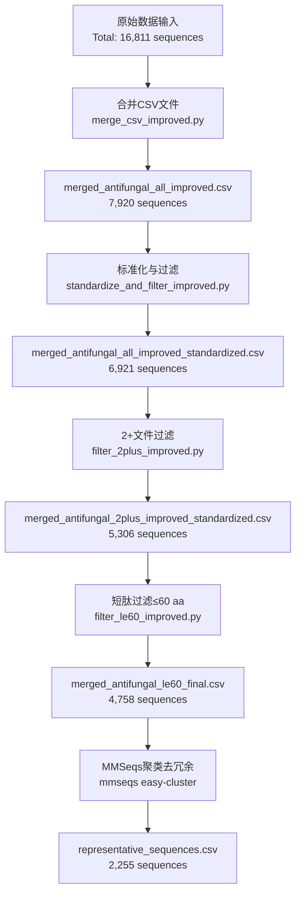

# Antifungal Peptide Data Processing Flowchart

## Data Processing Pipeline

## Processing Steps Detail

### Step 1: Original Data Files
| File | Sequence Count | Notes |
|------|----------------|-------|
| antifungal.csv | 5,708 | DRAMP antifungal peptide data |
| Antifungal_amps.csv | 1,836 | DRAMP antifungal peptide data |
| antifungal_peptides.csv | 1,813 | Antifungal peptide data |
| merged_data.csv | 562 | Merged data |
| peptides_merged.csv | 6,892 | Peptide merged data |
| **Total** | **16,811** | 5 original files |

### Step 2: Merge CSV Files
- **Input**: 5 original CSV files
- **Output**: `merged_antifungal_all_improved.csv`
- **Result**: 7,920 sequences (deduplicated and merged)

### Step 3: Standardization & Filtering
- **Input**: `merged_antifungal_all_improved.csv`
- **Processing**:
  - Sequence uppercase conversion
  - Filter non-standard amino acid sequences
- **Output**: `merged_antifungal_all_improved_standardized.csv`
- **Result**: 6,921 sequences

### Step 4: 2+ Files Filter
- **Input**: Standardized dataset
- **Processing**: Keep sequences appearing in ≥2 source files
- **Output**: `merged_antifungal_2plus_improved_standardized.csv`
- **Result**: 5,306 sequences (999 filtered out)

### Step 5: Short Peptide Filter (≤60 aa)
- **Input**: 2+ filtered dataset
- **Processing**: Filter sequences with length ≤60 amino acids
- **Output**: `merged_antifungal_le60_final.csv`
- **Result**: 4,758 sequences (548 filtered out)

### Step 6: MMSeqs Clustering (Deduplication)
- **Input**: `merged_antifungal_le60_final.csv`
- **Processing**: MMSeqs2 cluster with 100% identity threshold
- **Output**: `mmseq/representative_sequences.csv`
- **Result**: 2,255 representative sequences (2,503 redundant sequences removed)

## Data Loss Summary

| Step | Sequences | Lost | Lost % |
|------|------------|------|--------|
| Original | 16,811 | - | - |
| After Merge | 7,920 | 8,891 | 52.9% |
| After Standardization | 6,921 | 999 | 12.6% |
| After 2+ Filter | 5,306 | 1,615 | 23.3% |
| After Length Filter | 4,758 | 548 | 10.3% |
| After MMSeqs Clustering | 2,255 | 2,503 | 52.6% |

## Final Dataset Statistics
- **Total representative sequences**: 2,255
- **Sequence length**: ≤60 amino acids
- **Quality**: Standardized amino acids, appeared in ≥2 source databases, 100% identity clustering
- **Redundancy reduction**: 52.6%